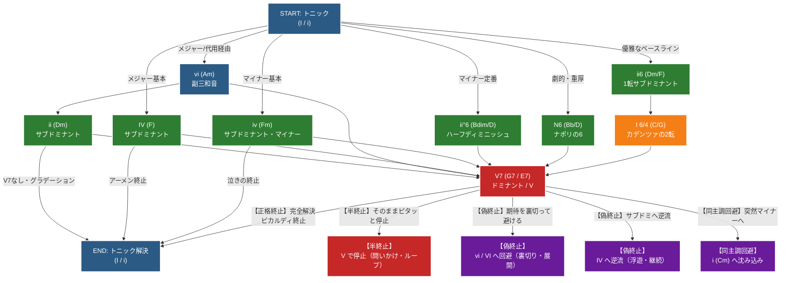

# 序．コード進行の分岐

古典的なコード進行でもこれだけのパターンが考えられます。

このパターンを統語規則の骨組みとし、語順を決定していきます。

TODO: 構文木になるように追加削除していく

## 1. メジャー（長調）のクラシカル進行

クラシックの基本は「トニック（$I$） $\rightarrow$ サブドミナント（$IV, ii$） $\rightarrow$ ドミナント（$V$） $\rightarrow$ トニック（$I$）」の完全なカデンツです。

① 王道の基本カデンツ（1度-4度-5度-1度）
- 進行: $I \rightarrow IV \rightarrow V7 \rightarrow I$
  - (例 / Cメジャー: C $\rightarrow$ F $\rightarrow$ G7 $\rightarrow$ C)
- 解説: 最も簡潔で力強い完全カデンツ（正格終止）です。バロック・古典派の楽曲の結びや、分かりやすい提示部で無数に使われます。
 
② クラシカルな最高峰「カデンツァ進行」（1度-2度-1度の2転-5度-1度）
- 進行: $I \rightarrow ii6 \rightarrow I$6^4 \rightarrow V7 \rightarrow I$
  - (例 / Cメジャー: C $\rightarrow$ Dm/F $\rightarrow$ C/G $\rightarrow$ G7 $\rightarrow$ C)
- 解説: クラシック音楽で最も優雅で完成された進行の一つです。
    - $ii6$（1転のDm）: ベース音が「F」となり、スムーズに繋がります。
    - $I$6^4$（2転のC）: ベース音がドミナントの「G」を先取りし、ドミナントへの準備と緊張を高めます（協奏曲のカデンツァ直前などで定番の形です）。

③ 和声的色彩を添える「副三和音経由」（1度-6度-2度-5度-1度）
- 進行: $I \rightarrow vi \rightarrow ii \rightarrow V7 \rightarrow I$
  - (例 / Cメジャー: C $\rightarrow$ Am $\rightarrow$ Dm $\rightarrow$ G7 $\rightarrow$ C)
- 解説: トニックの後に代用トニックである $vi$（Am）を挟むことで、メジャーの明るさの中にフッと影を落とし、そこから滑らかに $ii \rightarrow V$ へ繋げるロマンチックな進行です。
 
## 2. マイナー（短調）のクラシカル進行

マイナー（短調）では、ドミナント（$V$）に「和声的短音階（ハーモニック・マイナー）」由来の長三和音（またはドミナント7th）を使用し、強力な導音（#7度音）を作って着地させるのが鉄則です。

① マイナーの王道正格カデンツ
- 進行: $i \rightarrow iv \rightarrow V7 \rightarrow i$
  - (例 / Aマイナー: Am $\rightarrow$ Dm $\rightarrow$ E7 $\rightarrow$ Am)
- 解説: 劇的で哀愁を帯びたマイナーの最も純粋な進行です。$V7$（E7）の中に「G#（導音）」が含まれるため、最後の $i$（Am）への強い解決感が生まれます。
 
② クラシカル・マイナーの定番（ハーフディミニッシュ経由）
- 進行: $i \rightarrow ii^{\circ}6 \rightarrow V7 \rightarrow i$
  - (例 / Aマイナー: Am $\rightarrow$ Bdim/D $\rightarrow$ E7 $\rightarrow$ Am)
- 解説: クラシックの短調で非常に頻出する美しい進行です。$ii^{\circ}$（Bdim）の第1展開形（ベースがD）を使うことで、低音（ベースライン）が A $\rightarrow$ D $\rightarrow$ E $\rightarrow$ A と美しく跳躍・進行します。
 
③ 劇的・重厚な「ナポリの6」進行
- 進行: $i \rightarrow N6 \rightarrow V7 \rightarrow i$
  - (例 / Aマイナー: Am $\rightarrow$ Bb/D $\rightarrow$ E7 $\rightarrow$ Am)
- 解説: バロック・古典派（ベートーヴェンなど）がクライマックスで多用した伝統技法です。短2度上のメジャーコード（AマイナーならB♭）の第1展開形（N6）をサブドミナントとして挟むことで、一気に劇的で重厚な緊張感を作り出します。
 
## 3. 変格終止（プラガル・カデンス） $\rightarrow$ 「アーメン」の優しい着地

* **進行**: **$I \rightarrow IV \rightarrow I$**
* *(例 / Cメジャー: C $\rightarrow$ F $\rightarrow$ C)*

* **特徴**: 教会の賛美歌の最後で「アーメン」と歌われるときに必ず使われる進行（アーメン終止）です。
* **響き**: ドミナント（$V$や$V7$）の緊張感を通らず、サブドミナント（$IV$）の広がりから直接主音へ戻るため、**争いのない平和的な着地感**や、教会堂に響くような神聖な優しさが生まれます。

## 4. サブドミナント・マイナー終止 $\rightarrow$ 切なさを残す「泣きの着地」

* **進行**: **$I \rightarrow iv \rightarrow I$** （または $I \rightarrow VI \rightarrow iv \rightarrow I$）
* *(例 / Cメジャー: C $\rightarrow$ Fm $\rightarrow$ C)*

* **特徴**: メジャーキーの中に、あえてマイナーのサブドミナント（$iv$）を挟んでから主音へ戻る進行です。クラシックのロマン派や映画音楽で好まれます。
* **響き**: $V7$ のような強引な解決をしない代わりに、Fm（$iv$）に含まれるフラットの音（A♭）が胸を締め付けるような切なさを演出し、**「美しくも儚い余韻」を残して静かにトニックへ帰着**します。

## 5. サブドミナント・グラデーション進行 $\rightarrow$ 穏やかな回遊

* **進行**: **$I \rightarrow vi \rightarrow ii \rightarrow I$**
* *(例 / Cメジャー: C $\rightarrow$ Am $\rightarrow$ Dm $\rightarrow$ C)*

* **特徴**: ドミナント（G系）を完全にバイパスし、トニック（$I, vi$）とサブドミナント（$ii$）の柔らかなコードだけでぐるっと回って戻ってくる進行です。
* **響き**: バロック時代の室内楽や、静かなアンサンブル曲などでよく使われます。**トゲが一切なく、絹の上を滑るようななめらかな循環**が作れます。

## 6. 半終止（Half Cadence） $\rightarrow$ 「問いかけ」の終止

曲の途中（フレーズの区切り）で **ドミナント（$V$ や $V7$）のコードでそのままピタッと静止する** 進行です。

* **進行**: **$\dots \rightarrow (IV \text{ や } ii) \rightarrow \mathbf{V}$**
* *(例 / Cメジャー: Dm $\rightarrow$ **G**)*

* **響きと役割**:
* 音楽的には「……〜でしょうか？」と**質問を投げかけて息を呑むような未完感**が生まれます。
* 完全に曲が終わるのではなく、「次のフレーズで答え（$I$ への着地）が来る」ことを聴き手に期待させるため、Aメロの終わりやサビの前などで頻繁に使われます。

## 7. 偽終止（Deceptive Cadence） $\rightarrow$ 「期待を裏切る」終止

聴き手は「$V7 \rightarrow I$ でスッキリ終わるな」と予想しているところに、**$I$ ではなく代用トニックである $vi$（マイナー）や他のコードへ逃げる** 進行です。

* **進行（メジャー）**: **$\dots \rightarrow V7 \rightarrow \mathbf{vi}$**
* *(例 / Cメジャー: G7 $\rightarrow$ **Am**)*

* **進行（マイナー）**: **$\dots \rightarrow V7 \rightarrow \mathbf{VI}$**
* *(例 / Aマイナー: E7 $\rightarrow$ **F**)*

* **響きと役割**:
* 「ハッピーエンドで終わるかと思ったら、急に暗雲が立ち込めた」ようなドラマチックなハプニング（裏切り）を生み出します。
* クラシックでは、曲をすぐに終わらせず「もう1展開させる（フレーズを延長する）」ための超定番テクニックです。

## 8. その他の「$I$ に落ち着かない」クラシカルな回避進行

### ① サブドミナントへの偽終止（$V7 \rightarrow IV$）

* **進行**: **$V7 \rightarrow \mathbf{IV}$** *(例: G7 $\rightarrow$ **F**)*
* **響き**: 本来は $V7$ から $I$ へ向かうべきところを、あえてサブドミナント（$IV$）へ逆流させることで、一気に開放感と「えっ、まだ終わらないの？」という不思議な浮遊感を生み出します。

### ② ピカルディ終止の「逆」（メジャーからマイナーへの裏切り：$V7 \rightarrow i$）

* **進行**: **$V7 \rightarrow \mathbf{i}$** *(例 / Cメジャーの曲の途中で: G7 $\rightarrow$ **Cm**)*
* **響き**: メジャーキーで進んでいたにもかかわらず、最後の最後で同主調マイナーの $i$（Cm）へ着地する手法です。突然深い影が差し込むような強いドラマを生みます。
