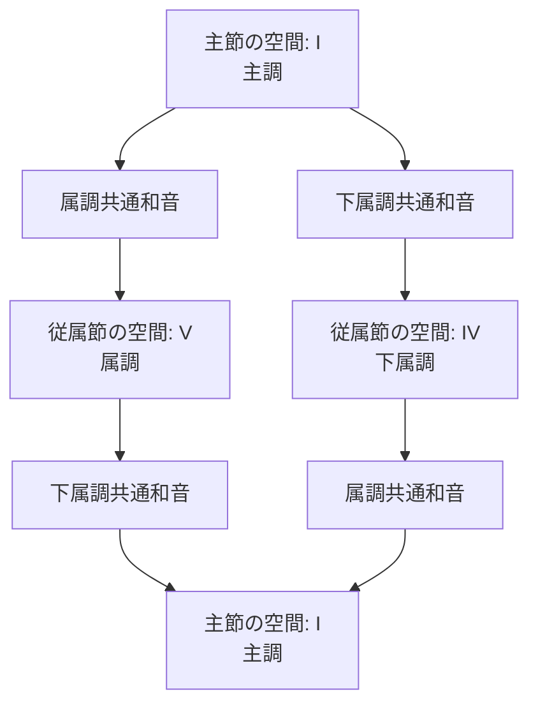

> メモ（書くべきこと）
> 語順とコード進行を紐づけ
> 能格言語にするか（文末に絶対格名詞を置いて終止形への影響を減らす）
> ピボットコードの選定

# １．基本語順と完全正終止

平叙文は、聞き手に対して応答（解決）を求めない自己完結する文型です。

**【平叙文の語順スロットとコード配置】**
```text
和音機能 : I[主語: 名詞] ─── ii/IV[助動詞/法] ─── V[動詞: 述語] ─── I[目的語: 名詞] ──> [文末主音]
```

```abc
"I"[C E G c]8 | "IV"[F, F A c]8 | "V"[G, G B d]8 | "I"[C E G c]8 | c8
```

**和声メカニズム:**
主語（*I*）から出発し、動詞（*V*）を経て、目的語であるトニック（*I*）へ着地します。この *I - V - I* という和声進行（完全正終止）が、文章における「命題の完結」として機能します。

**文末主音**: フレーズが不完全終止で終わった場合に追加する主音ド（通常Cの音）。ピリオドの役割。解決感があり言い切った感じを補強する。

# ２．疑問文と半終止

疑問文は、聞き手に対して応答（解決）を求める文型です。

**【疑問文の進行と構造】**
```text
和音機能 :  ii/IV[呼びかけ詞] ──> I[主語: 名詞] ──> I[目的語: 名詞] ──> V[動詞: 述語] ──> [文末導音]
```

```abc
"ii"[A, D F A]8 | "I"[C E G c]8 | "I"[C E G c]8 | "V"[G, G B d]8 | B8
```

**和声メカニズム:**
文頭に呼びかけ詞である `ii/IV`（サブドミナント）を置きます（なくてもよい）。
語順が **主語-目的語-動詞** に変化し、述語である `V` コード（ドミナント）が文末に配置されます。自然言語では強調したい句を文頭に配置しますが(英語における疑問文の倒置順など)、本言語では話終わりに余韻が残る文末が強調したい句の配置場所になります。
平叙文のような文末主音（*C* 音）を配置せず、ドミナント（*V*）の緊張状態のまま進行を保留（半終止）します。これにより、音響的に「話が未解決であり、続き（応答）が必要である」状態を作り出します。

**文末導音**: フレーズを強調したい場合に追加する導音シ（通常Bの音）。すぐに主音ドを鳴らして解決感を得たくなる心理的効果がある。疑問符の役割。

**【ぼかし表現】**

```text
和音機能 : I[主語: 名詞] ──> V[動詞: 述語] ──> I[目的語: 名詞] ──> IV[文末詞]
```

```abc
"I"[C E G c]8 | "V"[G, G B d]8 | "I"[C E G c]8 | "IV"[A, A c f]8 | 
```

**和声メカニズム:**
平叙文に文末詞を付け加えて疑問形とする表現。
*IV* の和音の終止も *V* ほどではないが未解決感があり、IVの和音の半終止として半終止の仲間に入れることもある。
日本語で言うと「～だよね？」「～だと思う」のような表現。


## 話者間応答カデンツ（対話における Yes / No 応答）

疑問文によって生じた和声的未解決（*V* 音の緊張）を、対話相手（話者B）がどのように処理するかによって、肯定（Yes）と否定（No）を表現します。

* **肯定応答（Yes）:** 話者Aが残した *V* の緊張を引き継ぎ、1句目をトニック *I* で応答（'Yes'を意味するフレーズ）し正終止的な進行をさせてから文を続けます（＝「提示された命題をそのまま受け入れて閉じる」）。
```abc
"V"[G, G B d]8 | "I"[C E G c]8
```

* **否定応答（No）:** 話者Aの *V* からの自然な解決をせず、1句目を代理トニック *vi* （'No'を意味するフレーズ）で応答し偽終止的な進行をさせてから文を続けます（＝「命題の解決方向を変更して閉じる」）。
```abc
"V"[G, G B d]8 | "vi"[A, A c e]8
```

# ３．ピボットコードによる属調・下属調への転調と関係節・従属節の文法

自然言語では、文の中に別の節を埋め込む「複文（主節と従属節・関係節）」が存在します。本言語では、「属調や下属調への一時的転調と主調への帰還」を用いて、節の埋め込み構造を表現します。

## ピボットコード（共通和音）による転調の仕組み

主節の調（C Ionian）から従属節へ入る際、両方の調に共通して含まれる和音（ピボットコード）を「出入口（接続詞）」として使用します。これにより、和声的な連続性を保ったまま別の調の空間へ移動します。



### 属調共通和音

主調から属調への転調、または下属調から主調への帰還で使用する和音です。

|主調 (I)		|属調 (V)		|転調時のポイント		|言語的意義	|
|---|---|---|---|
|I (Imaj7)		|IV (IVmaj7)	|主調の主音から、属調の下属音へスムーズに移行できます。|	|
|IIIm (IIIm7)	|VIm (VIm7)		|どちらのキーでも暗い響き（マイナー）の代理コードとして機能します。|	|
|V (V7,Vmaj7)	|I (Imaj7)		|主調のドミナント（V7）が、そのまま属調の主音（I）に着地します。|関係節側の主語にもなる	|
|VIm (VIm7)		|IIm (IIm7)		|キーGの「IIm - V7 - I（Am7 - D7 - G）」のツーファイブに綺麗に繋がります。|	|

### 下属調共通和音

主調から下属調への転調、または属調から主調への帰還で使用する和音です。

|主調 (I)	|下属調 (IV)	|転調時のポイント|言語的意義	|
|---|---|---|---|
|I (I7,Imaj7)	|V (V7)	|「C7」はキーFのドミナントになり強力に転調（セカンダリードミナント化）できます。|直後に主語(T)を置く縛り|
|IIm (IIm7)		|VIm (VIm7)	|キーCの定番コードから、キーFのトニック（代理）へ自然に滑り込めます。||
|IV (IVmaj7)	|I (Imaj7)	|キーCのサブドミナントが、そのままキーFの主音（F）に着地します。||
|VIm (VIm7)		|IIIm (IIIm7)	|切ない響きを残したまま、キーFの世界観へ橋渡しができます。||

## 属調への転調：主格関係節・目的格関係節

主格関係節（who）や目的格関係節（which）などを形成する場合、主調（C Major）と属調（G Major）の両方に存在する **`Am` コード（$vi$）** をポータルとして使用します。

* **適用構文:** 主格関係節（who）、目的格関係節（which）
* **進行プロセス:**
1. 主節内で `Am` コードを置く（従属節の開始標識）。
2. 属調（G Major）の空間内で節の内容を展開する。
3. 節の終了時、属調のドミナントから主調のトニックへ向けて帰還進行を行い、主節へ戻る。

```text
【属調ピボット転調の構造（例: When I eat, ...）】
主節空間            ポータル            従属節内部 (G Major)           主節復帰
 [C]  ───────────>  [Am]  ───────────>  [Cmaj7] ──> [D7] ──> [G] ───> [G7] ──> [C]
(トニック)        (ピボット)            (節の主体)  (属調V)  (属調I)   (主節V) (主節I)

```

## 下属調への転調：条件節・時間節・補文節

時間節（when）や条件節（if）、引用・補文節（that）を形成する場合、**`C7` コード（$I7$）** をポータルとして使用します。`C7` に含まれる $B\flat$（♭7th）音が、下属調（F Major）への移動を音響的に示します。

* **適用構文:** 条件節（if）、時間節（when）、原因節（because）、引用・補文節（that）
* **進行プロセス:**
1. 主節内で `C7` コードを置く（目的格節の開始標識）。
2. 下属調（F Major）の空間内で節の内容を展開する。
3. 節の終了時、ドミナントモーション（$G7 \to C$）により主調（C Ionian）へ即座に復帰する。

### 5.4 統語論的意味：和声的ブラケット（カッコの開閉）

自然言語における従属節は、書き言葉では「カッコ `[ ]` 」によって範囲が明示されます。本システムでは、以下の音響処理がカッコの開閉に対応します。

* **カッコを開く（`[`）:** ピボットコード（`Am` または `C7`）による転調。
* **カッコを閉じる（`]`）:** 主調のドミナントからトニックへの着地（`G7 -> C`）。

これにより、どれほど複雑な節構造であっても、聴取者は「今どの調の空間にいるか」によって節の深さを把握し、最終的に主調トニック $C$ に着地した時点で文全体が完結したことを正確に認知できます。
