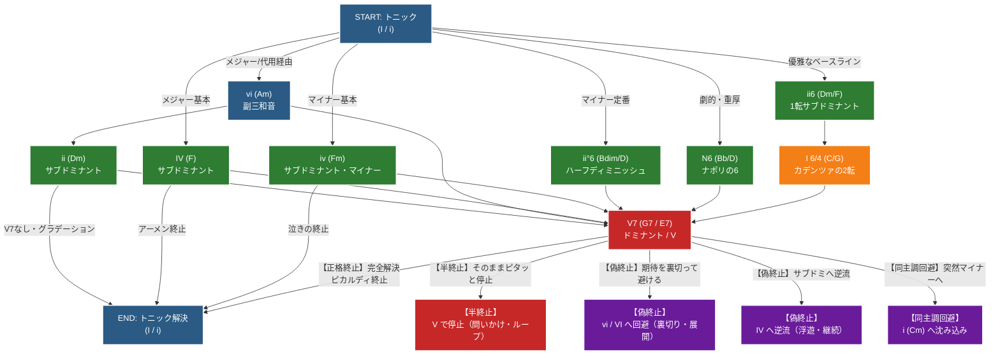
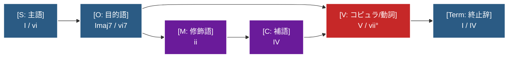
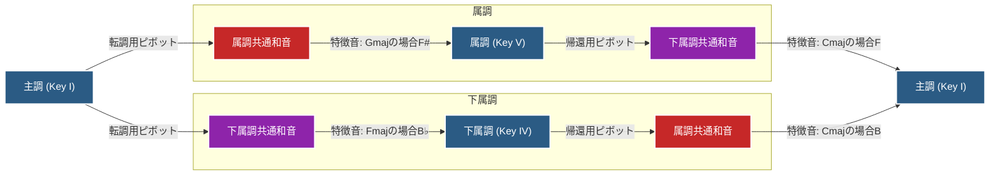
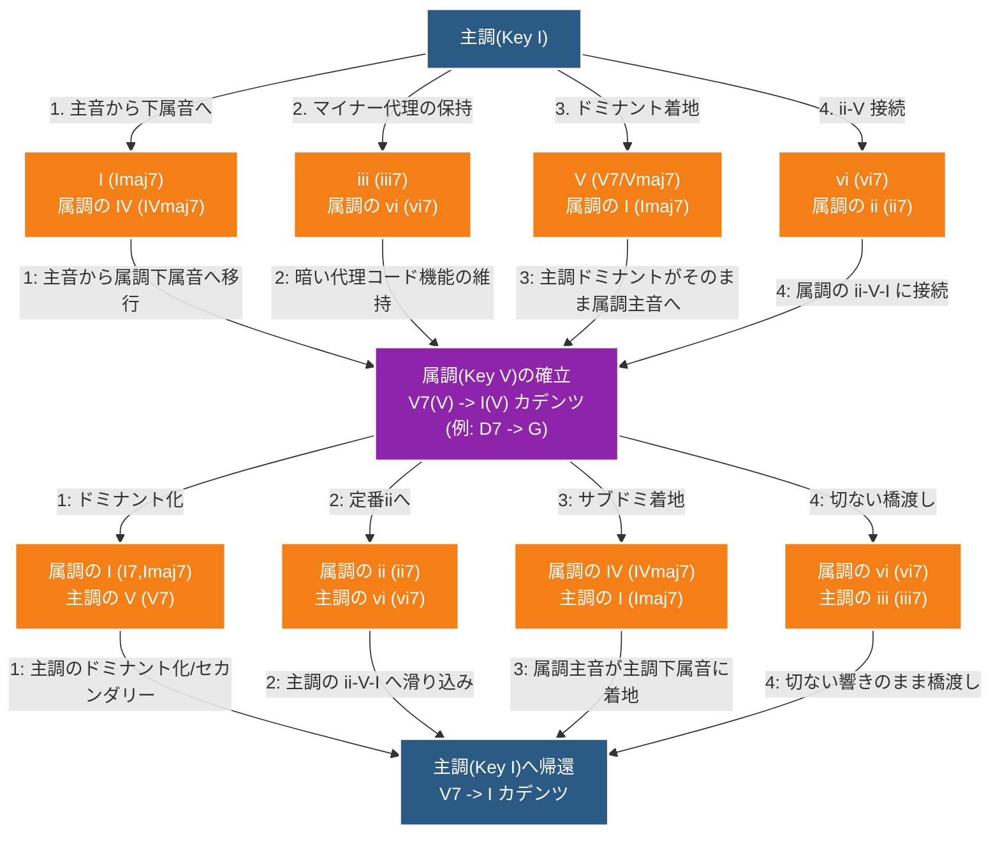

> メモ（書くべきこと）

> 語順とコード進行を紐づけ、使えるコード進行の捜索

> 能格言語にするか（文末に絶対格名詞を置いて終止形への影響を減らす）

> ピボットコードの選定

# 序．コード進行の分岐

古典的なコード進行でもこれだけのパターンが考えられます。

このパターンを統語規則の骨組みとし、語順を決定していきます。

TODO: 構文木になるように追加削除していく



## 1. メジャー（長調）のクラシカル進行

クラシックの基本は「トニック（$I$） $\rightarrow$ サブドミナント（$IV, ii$） $\rightarrow$ ドミナント（$V$） $\rightarrow$ トニック（$I$）」の完全なカデンツです。

① 王道の基本カデンツ（1度-4度-5度-1度）
- 進行: $I \rightarrow IV \rightarrow V7 \rightarrow I$
  - (例 / Cメジャー: C $\rightarrow$ F $\rightarrow$ G7 $\rightarrow$ C)
- 解説: 最も簡潔で力強い完全カデンツ（正格終止）です。バロック・古典派の楽曲の結びや、分かりやすい提示部で無数に使われます。
 
② クラシカルな最高峰「カデンツァ進行」（1度-2度-1度の2転-5度-1度）
- 進行: $I \rightarrow ii6 \rightarrow I$6^4 \rightarrow V7 \rightarrow I$
  - (例 / Cメジャー: C $\rightarrow$ Dm/F $\rightarrow$ C/G $\rightarrow$ G7 $\rightarrow$ C)
- 解説: クラシック音楽で最も優雅で完成された進行の一つです。
    - $ii6$（1転のDm）: ベース音が「F」となり、スムーズに繋がります。
    - $I$6^4$（2転のC）: ベース音がドミナントの「G」を先取りし、ドミナントへの準備と緊張を高めます（協奏曲のカデンツァ直前などで定番の形です）。

③ 和声的色彩を添える「副三和音経由」（1度-6度-2度-5度-1度）
- 進行: $I \rightarrow vi \rightarrow ii \rightarrow V7 \rightarrow I$
  - (例 / Cメジャー: C $\rightarrow$ Am $\rightarrow$ Dm $\rightarrow$ G7 $\rightarrow$ C)
- 解説: トニックの後に代用トニックである $vi$（Am）を挟むことで、メジャーの明るさの中にフッと影を落とし、そこから滑らかに $ii \rightarrow V$ へ繋げるロマンチックな進行です。
 
## 2. マイナー（短調）のクラシカル進行

マイナー（短調）では、ドミナント（$V$）に「和声的短音階（ハーモニック・マイナー）」由来の長三和音（またはドミナント7th）を使用し、強力な導音（#7度音）を作って着地させるのが鉄則です。

① マイナーの王道正格カデンツ
- 進行: $i \rightarrow iv \rightarrow V7 \rightarrow i$
  - (例 / Aマイナー: Am $\rightarrow$ Dm $\rightarrow$ E7 $\rightarrow$ Am)
- 解説: 劇的で哀愁を帯びたマイナーの最も純粋な進行です。$V7$（E7）の中に「G#（導音）」が含まれるため、最後の $i$（Am）への強い解決感が生まれます。
 
② クラシカル・マイナーの定番（ハーフディミニッシュ経由）
- 進行: $i \rightarrow ii^{\circ}6 \rightarrow V7 \rightarrow i$
  - (例 / Aマイナー: Am $\rightarrow$ Bdim/D $\rightarrow$ E7 $\rightarrow$ Am)
- 解説: クラシックの短調で非常に頻出する美しい進行です。$ii^{\circ}$（Bdim）の第1展開形（ベースがD）を使うことで、低音（ベースライン）が A $\rightarrow$ D $\rightarrow$ E $\rightarrow$ A と美しく跳躍・進行します。
 
③ 劇的・重厚な「ナポリの6」進行
- 進行: $i \rightarrow N6 \rightarrow V7 \rightarrow i$
  - (例 / Aマイナー: Am $\rightarrow$ Bb/D $\rightarrow$ E7 $\rightarrow$ Am)
- 解説: バロック・古典派（ベートーヴェンなど）がクライマックスで多用した伝統技法です。短2度上のメジャーコード（AマイナーならB♭）の第1展開形（N6）をサブドミナントとして挟むことで、一気に劇的で重厚な緊張感を作り出します。
 
## 3. 変格終止（プラガル・カデンス） $\rightarrow$ 「アーメン」の優しい着地

* **進行**: **$I \rightarrow IV \rightarrow I$**
* *(例 / Cメジャー: C $\rightarrow$ F $\rightarrow$ C)*


* **特徴**: 教会の賛美歌の最後で「アーメン」と歌われるときに必ず使われる進行（アーメン終止）です。
* **響き**: ドミナント（$V$や$V7$）の緊張感を通らず、サブドミナント（$IV$）の広がりから直接主音へ戻るため、**争いのない平和的な着地感**や、教会堂に響くような神聖な優しさが生まれます。

## 4. サブドミナント・マイナー終止 $\rightarrow$ 切なさを残す「泣きの着地」

* **進行**: **$I \rightarrow iv \rightarrow I$** （または $I \rightarrow VI \rightarrow iv \rightarrow I$）
* *(例 / Cメジャー: C $\rightarrow$ Fm $\rightarrow$ C)*


* **特徴**: メジャーキーの中に、あえてマイナーのサブドミナント（$iv$）を挟んでから主音へ戻る進行です。クラシックのロマン派や映画音楽で好まれます。
* **響き**: $V7$ のような強引な解決をしない代わりに、Fm（$iv$）に含まれるフラットの音（A♭）が胸を締め付けるような切なさを演出し、**「美しくも儚い余韻」を残して静かにトニックへ帰着**します。

## 5. サブドミナント・グラデーション進行 $\rightarrow$ 穏やかな回遊

* **進行**: **$I \rightarrow vi \rightarrow ii \rightarrow I$**
* *(例 / Cメジャー: C $\rightarrow$ Am $\rightarrow$ Dm $\rightarrow$ C)*


* **特徴**: ドミナント（G系）を完全にバイパスし、トニック（$I, vi$）とサブドミナント（$ii$）の柔らかなコードだけでぐるっと回って戻ってくる進行です。
* **響き**: バロック時代の室内楽や、静かなアンサンブル曲などでよく使われます。**トゲが一切なく、絹の上を滑るようななめらかな循環**が作れます。

## 6. 半終止（Half Cadence） $\rightarrow$ 「問いかけ」の終止

曲の途中（フレーズの区切り）で **ドミナント（$V$ や $V7$）のコードでそのままピタッと静止する** 進行です。

* **進行**: **$\dots \rightarrow (IV \text{ や } ii) \rightarrow \mathbf{V}$**
* *(例 / Cメジャー: Dm $\rightarrow$ **G**)*


* **響きと役割**:
* 音楽的には「……〜でしょうか？」と**質問を投げかけて息を呑むような未完感**が生まれます。
* 完全に曲が終わるのではなく、「次のフレーズで答え（$I$ への着地）が来る」ことを聴き手に期待させるため、Aメロの終わりやサビの前などで頻繁に使われます。

## 7. 偽終止（Deceptive Cadence） $\rightarrow$ 「期待を裏切る」終止

聴き手は「$V7 \rightarrow I$ でスッキリ終わるな」と予想しているところに、**$I$ ではなく代用トニックである $vi$（マイナー）や他のコードへ逃げる** 進行です。

* **進行（メジャー）**: **$\dots \rightarrow V7 \rightarrow \mathbf{vi}$**
* *(例 / Cメジャー: G7 $\rightarrow$ **Am**)*


* **進行（マイナー）**: **$\dots \rightarrow V7 \rightarrow \mathbf{VI}$**
* *(例 / Aマイナー: E7 $\rightarrow$ **F**)*


* **響きと役割**:
* 「ハッピーエンドで終わるかと思ったら、急に暗雲が立ち込めた」ようなドラマチックなハプニング（裏切り）を生み出します。
* クラシックでは、曲をすぐに終わらせず「もう1展開させる（フレーズを延長する）」ための超定番テクニックです。

## 8. その他の「$I$ に落ち着かない」クラシカルな回避進行

### ① サブドミナントへの偽終止（$V7 \rightarrow IV$）

* **進行**: **$V7 \rightarrow \mathbf{IV}$** *(例: G7 $\rightarrow$ **F**)*
* **響き**: 本来は $V7$ から $I$ へ向かうべきところを、あえてサブドミナント（$IV$）へ逆流させることで、一気に開放感と「えっ、まだ終わらないの？」という不思議な浮遊感を生み出します。

### ② ピカルディ終止の「逆」（メジャーからマイナーへの裏切り：$V7 \rightarrow i$）

* **進行**: **$V7 \rightarrow \mathbf{i}$** *(例 / Cメジャーの曲の途中で: G7 $\rightarrow$ **Cm**)*
* **響き**: メジャーキーで進んでいたにもかかわらず、最後の最後で同主調マイナーの $i$（Cm）へ着地する手法です。突然深い影が差し込むような強いドラマを生みます。

これまで議論・合意してきた**SOV語順への刷新**、**名詞階層（代名詞＝$I$、普通名詞＝$vi$、同種連鎖時のセブンス化）**、および**コピュラ（$V$）＋ 終止辞（Terminal Particle / CP）による文末モダリティ体系**を反映し、設計書の該当セクションを全面修正・再構築いたしました。

ご指摘の通り、文末の終止形（カデンツ）をコントロールして確信度や態度を表すメカニズムは、Cadentianにおいて「終止辞（Terminal Particle）」によるモダリティ制御という主役級の言語機能として位置付けられます。

# １．基本語順（SOV）と完全正終止（平叙文：事実）

平叙文は、命題を提示し、聞き手に対して応答（解決）を求めず自己完結（事実）する基本文型です。

**【平叙文の語順スロットとコード配置】**



```abc
"I"[C E G c]8 | "vi7"[A, C E g]8 | "V"[G, G B d]8 | "Term(I)"[C E G c]8 | C8
```

**和声メカニズム:**

* **語順（SOV）:** 主語（S）から出発し、目的語/補語（O）を経て、述語化標識であるコピュラ `V`（ドミナント）で緊張を高めた後、文末の終止辞 `Term`（トニック *I* ）へ着地します。
* **格と名詞の識別:**
  * **代名詞・指示詞:** 主音・原点である **$I$** を使用。
  * **普通名詞:** 代理トニックである **$vi$** を使用。
  * **同種名詞の連鎖（S-O重複）:** 名詞が連続する場合（例：普通名詞＋普通名詞）和声進行が停滞することを回避するため、後置される側を **セブンス化（$vi_7$ や $I_7$）** して `V` への引力・緊張を高めます。これは対格 / 目的格（O）の格変化にあたります（→[品詞と和声機能](/morphology.md)）。
* **完全正終止（$V \to I$）:** *V - I* という正終止カデンツが、「命題の確定・100%の事実宣言（直説法）」として機能します。
* **文末主音**: 文末に追加する主音（通常 C の音）。ピリオド（句点）の役割を果たし、明確な着地感と言い切りを調性的に補強します。フレーズが不完全終止し終止感が足りない場合に使いますが、モダリティとしてあえて使わない場合もあります。

# ２．文末モダリティ（終止辞）による発話態度の制御

Cadentianでは、コピュラ `V`（ドミナント）が生成する「命題関係付けの緊張（矢印）」を**どのように着地（半終止・偽終止・変格終止）させるか**によって、文全体のモダリティ（断定・疑問・推量・緩和）を一括制御します。

### 疑問文（半終止：V打ち切り）

聞き手に対して応答（解決）を求める文型です。

**【疑問文の進行と構造】**

```abc
"I"[C E G c]8 | "vi7"[A, C E g]8 | "V"[G, G B d]8 | B8
```

**和声メカニズム:**
* 語順はSOVを維持したまま、文末のコピュラ `V`（ドミナント）の緊張状態のまま進行をピタッと停止（半終止）させます。
* 音響的に「命題の解決が未完了であり、相手からの解決（応答）が必要である」という空洞を生み出し、疑問・確認（「〜か？」）を表現します。
* **文末導音**: フレーズを強調したい場合に追加する導音（通常 B の音）。すぐに主音へ解決させたくなる心理的効果により、クエスチョンマーク（疑問符）として機能します。

### 推量表現（変格終止・緩和：V → IV）

100%の断定を避け、柔らかいニュアンスや推量を表す文型です。

**【推量・ぼかしの進行と構造】**

```abc
"I"[C E G c]8 | "vi7"[A, C E g]8 | "V"[G, G B d]8 | "Term(IV)"[F, F A c]8 |
```

**和声メカニズム:**
コピュラ `V` の強い緊張から、期待される完全解決（*I*）をあえて避け、浮遊感のあるサブドミナント `IV` へ着地・減衰させます（変格終止 / アーメン終止的アプローチ）。
100%確定させない余白を作ることで、日本語の「〜でしょう」「〜だと思う」「〜かな（推量・緩和）」に相当するモダリティを表現します。

### 疑問文（半終止：V打ち切り）

聞き手に対して応答（解決）を求める文型です。

**【疑問文の進行と構造】**

```abc
"I"[C E G c]8 | "vi7"[A, C E g]8 | "V"[G, G B d]8 | B8
```

**和声メカニズム:**
* 語順はSOVを維持したまま、文末のコピュラ `V`（ドミナント）の緊張状態のまま進行をピタッと停止（半終止）させます。
* 音響的に「命題の解決が未完了であり、相手からの解決（応答）が必要である」という空洞を生み出し、疑問・確認（「〜か？」）を表現します。
* **文末導音**: フレーズを強調したい場合に追加する導音（通常 B の音）。すぐに主音 C へ解決させたくなる心理的欲求を刺激し、クエスチョンマーク（疑問符）として機能します。

## 話者間応答カデンツ（対話における Yes / No 応答）

疑問文によって生じた和声的未解決（`V` 音の緊張）を、対話相手（話者B）が文頭でどのように回収（解決）するかによって、肯定（Yes）と否定（No）を即座に明示します。

* **肯定応答（Yes）:** 話者Aが残した `V` の緊張をそのまま受け入れ、1句目の文頭終止辞としてトニック **$I$** で着地させてから応答文を続けます（＝「提示された命題をそのまま受け入れて正終止させる」）。

```abc
"V"[G, G B d]8 | "I"[C E G c]8
```

* **否定応答（No）:** 話者Aの `V` からの自然な正終止を拒否し、1句目の文頭で代理トニック **$vi$** または同主短調の **$i$ ($Cm$)** へ着地させて偽終止を起こしてから応答文を続けます（＝「提示された命題の解決方向を拒絶・変更する」）。

```abc
"V"[G, G B d]8 | "vi"[A, A c e]8
```

# ３．ピボットコードによる属調・下属調への転調と関係節・従属節の文法

自然言語では、文の中に別の節を埋め込む「複文（主節と従属節・関係節）」が存在します。本言語では、「属調や下属調への一時的転調と主調への帰還」を用いて、節の埋め込み構造を表現します。

## 共通和音（ピボットコード）による転調の仕組み

主節の調から従属節の調へ入る際、両方の調に共通して含まれる和音（ピボットコード）を「出入口（接続詞）」として使用します。これにより、和声的な連続性を保ったまま別の調の空間へ移動します。

認知上では共通和音が鳴った時点では転調したとは感じません。その後、転調先特有の音（特徴音）が鳴ったときに調の重心が完全に引っ越し転調したと感じます。



### 属調共通和音

主調から属調への転調、または下属調から主調への帰還で使用する和音です。

| 主調 (I)           | 属調 (V)        | 転調時のポイント                                                    |
| ------------------ | --------------- | ------------------------------------------------------------------- |
| $I$ ($Imaj7$)      | $IV$ ($IVmaj7$) | 主調の主音から、属調の下属音へスムーズに移行できます。              |
| $iii$ ($iii7$)     | $vi$ ($vi7$)    | どちらのキーでも暗い響きの代理コードとして機能します。              |
| $V$ ($V7$,$Vmaj7$) | $I$ ($Imaj7$)   | 主調のドミナント（$V7$）が、そのまま属調の主音（$I$）に着地します。 |
| $vi$ ($vi7$)       | $ii$ ($ii7$)    | 属調の「$ii - V7 - I$」のツーファイブワン進行に綺麗に繋がります。   |

### 下属調共通和音

主調から下属調への転調、または属調から主調への帰還で使用する和音です。

| 主調 (I)           | 下属調 (IV)    | 転調時のポイント                                                               |
| ------------------ | -------------- | ------------------------------------------------------------------------------ |
| $I$ ($I7$,$Imaj7$) | $V$ ($V7$)     | $I7$は下属調のドミナントになり強力に転調（セカンダリードミナント化）できます。 |
| $ii$ ($ii7$)       | $vi$ ($vi7$)   | 主調の定番コードから、下属調のトニック（代理）へ自然に滑り込めます。           |
| $IV$ ($IVmaj7$)    | $I$ ($Imaj7$)  | 主調のサブドミナントが、そのまま下属調の主音に着地します。                     |
| $vi$ ($vi7$)       | $iii$ ($iii7$) | 短調の響きを残したまま、下属調の世界観へ橋渡しができます。                     |

このように、使用する共通和音により従属節への繋がりの雰囲気および従属節の文頭の品詞が決まり、従属節がどのような文法範疇を担うかを規定することができます。

## トニック $I$ と 代理トニック $vi$ への転調、１２の後置修飾詞

共通和音の中には転調先での和声機能が同一のものがあり トニック $I$ 系と代理トニック $vi$ 系に大別できます。

これらに主調内の同機能和声を合わせ、それぞれを「主調を維持・属調へ転調・下属調へ転調」への入り口とし、さらに短調への移調も合わせることで１２パターンの分岐構造を導入します。

### 1. トニック系統（$I$ / $V$ / $IV$ ベース）

主に「主語（名詞）を提示しながら時制・空間を決定する」関係代名詞、関係副詞的な群です。

| ゲート名                   | 使用コード | 転調先（到達キー）   | 主な言語・文法機能                 |
| -------------------------- | ---------- | -------------------- | ---------------------------------- |
| **現在・肯定（主調）**     | $I$        | **主調** ($I$)       | **現在時制**・平叙文（〜である）   |
| **未来・確信（属調）**     | $V$        | **属調** ($I$)       | **未来時制**・確信（〜するだろう） |
| **過去・確定（下属調）**   | $IV$       | **下属調** ($I$)     | **過去時制**・確定事実（〜した）   |
| **現在・否定（主調陰）**   | $i$        | **同主短調** ($i$)   |                                    |
| **未来・推量（属調陰）**   | $v$        | **属調短調** ($i$)   |                                    |
| **過去・回想（下属調陰）** | $iv$       | **下属調短調** ($i$) |                                    |

---

### 2. 代理トニック系統（$vi$ / $iii$ / $ii$ ベース）

主に「条件・背景・修飾（副詞節や関係節）から入りながら時制・空間を決定する」ゲート群です。

| ゲート名                   | 使用コード | 転調先（到達キー）    | 主な言語・文法機能                |
| -------------------------- | ---------- | --------------------- | --------------------------------- |
| **現在・逆説（主調陽）**   | $VI$       | **主調** ($VI$)       |                                   |
| **未来・目的（属調陽）**   | $III$      | **属調** ($VI$)       |                                   |
| **過去・起点（下属調陽）** | $II$       | **下属調** ($VI$)     |                                   |
| **現在・背景（主調）**     | $vi$       | **同主短調** ($vi$)   |                                   |
| **未来・条件（属調）**     | $iii$      | **属調短調** ($vi$)   |                                   |
| **過去・継続（下属調）**   | $ii$       | **下属調短調** ($vi$) |                                   |

## 属調への転調

属調への転調は、音響的に「少し持ち上がる・進展する」という推進力を持ちます。



| 主調 (I)             | 属調 (V) での機能         | ゲートとしての文法機能案                                   | 解説・具体的な使われ方                                                                                                                                                                |
| -------------------- | ------------------------- | ---------------------------------------------------------- | ------------------------------------------------------------------------------------------------------------------------------------------------------------------------------------- |
| **$I$ ($I_{maj}7$)** | **$IV$** (サブドミナント) | **条件・原因節**<br>（*if / because / when*）              | 下属音（$IV$）は「物語を展開させるきっかけ」の音響特性を持ちます。<br>例: *If (I)...* や *Because (I)...* と切り出すゲート。直後に属調の主語（$I$）へスムーズに接続できます。         |
| **$iii$**            | **$vi$** (代理トニック)   | **逆説・対比節**<br>（*although / whereas*）               | 短調（マイナー）の陰りを持つため、「〜であるにもかかわらず」「一方で〜は」といった**逆説的・背景的な条件節**に。                                                                      |
| **$V$ ($V7$)**       | **$I$** (トニック)        | **主格関係代名詞 / 関係副詞**<br>（*who / which / where*） | 主調のドミナント（$V$）がそのまま属調の主音（$I$＝名詞）として着地するため、**「〜である（人物/場所）は…」という関係代名詞の主語**にそのままなれます。                                |
| **$vi$**             | **$ii$** (サブドミナント) | **目的・結果節**<br><br>（*so that / in order to*）        | 属調の『$ii - V7 - I$（ツーファイブワン）』という最も強烈な動的進行へ繋がるため、「（〜するために）〜する」という**目的や必然的な結果**へ向かう強いベクトルを持たせることができます。 |

## 下属調への転調：条件節・時間節・補文節

下属調への転調は、♭音（$B\flat$）が加わることで「沈み込む・引用する・他者の視点に入る」という柔らかい包摂性を持ちます。

| 主調 (I) | 下属調 (IV) での機能     | ゲートとしての文法機能案                                                   | 解説・具体的な使われ方                                                                                                                                                                                                                                                                                                                          |
| -------- | ------------------------ | -------------------------------------------------------------------------- | ----------------------------------------------------------------------------------------------------------------------------------------------------------------------------------------------------------------------------------------------------------------------------------------------------------------------------------------------- |
| **$I7$** | **$V7$** (ドミナント)    | **補文標識・引用・伝聞**<br>（*that / say that / hear that*）              | 主調のトニックに $B\flat$ が入った $I7$ は、下属調における強烈な**ドミナント（$V7$）**になります。ドミナントは「次にトニック（名詞・主語）を強く要求する」ため、**「[主語が〜した]と（思う/言う/聞く）」という that 節（補文）の直前**に置くことで、直後に下属調の主語（$T$）を強烈に引き寄せるゲート（代動詞的・導入的ドミナント）になります。 |
| **$ii$** | **$vi$** (代理トニック)  | **時間的経過・過去回想**<br>（*after / since / when*）                     | 和声的に柔らかく滑り込めるため、「〜したあとで」「〜して以来」といった**時間的な回想・経過を示す副詞節**の入口になります。                                                                                                                                                                                                                      |
| **$IV$** | **$I$** (トニック)       | **目的格関係代名詞 / 引用された主語**<br>（*whom / which / "He said..."*） | 主調のサブドミナント（$IV$）が下属調のトニック（$I$）へ直接着地します。**「（私が選んだ）その apple は…」といった目的格関係節**や、**引用文の中の主語**として直接機能します。                                                                                                                                                                   |
| **$vi$** | **$iii$** (メディアント) | **譲歩・仮定の疑問**<br>（*even if / whether*）                            | 浮遊感のある $iii$ へ着地するため、「たとえ〜であっても」「〜かどうか」という**結果が不確定な仮定節**のゲートとして機能します。                                                                                                                                                                                                                 |

## 統語論的意味：和声的ブラケット（カッコの開閉）

自然言語における従属節は、書き言葉では「カッコ `[ ]` 」によって範囲が明示されます。本システムでは、以下の音響処理がカッコの開閉に対応します。

* **カッコを開く（`[`）:** ピボットコード（`Am` または `C7`）による転調。
* **カッコを閉じる（`]`）:** 主調のドミナントからトニックへの着地（`G7 -> C`）。

これにより、どれほど複雑な節構造であっても、聴取者は「今どの調の空間にいるか」によって節の深さを把握し、最終的に主調トニック $C$ に着地した時点で文全体が完結したことを認知できます。
